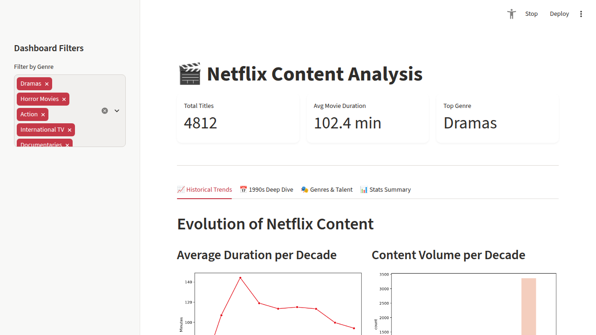

# 🎬 Investigating Netflix Movies

Explore Netflix movie data through an interactive Streamlit dashboard and a
Jupyter Notebook analysis focused on movie trends, genres, directors, and the
1990s.

## 🚀 Live Demo

**[Open the Netflix Content Analysis Dashboard](https://investigating-netflix-movies-ehimlffv3atmdxcr3dkrmw.streamlit.app/)**

## 🖼️ Website Preview



## 📌 Overview

This project analyzes Netflix content using Python and presents the results in
an interactive dashboard. The dashboard includes historical trends, a focused
analysis of 1990s movies, genre and director breakdowns, descriptive
statistics, data-quality checks, and an optional raw-data table.

## ✨ Features

- Filter titles by genre.
- View total titles, average movie duration, and the most common genre.
- Compare average movie duration and movie volume by decade.
- Explore movie-duration distributions.
- Analyze 1990s movie durations and top genres.
- Review genre share and the most prolific directors.
- Inspect correlation, numeric statistics, categorical statistics, and raw data.
- Filter by content type, genre, release year, and duration.
- Download the filtered dataset as a CSV for further analysis.
- Audit missing values and duplicate rows before making conclusions.

## 📈 Analyst Techniques Demonstrated

This project uses practical techniques commonly expected in current data
analyst and business intelligence roles:

- **Exploratory data analysis (EDA):** distributions, summary statistics, and
  segment comparisons.
- **KPI design:** filtered title count, movie share, average duration, and top
  genre.
- **Time-series analysis:** title volume by release year and average duration
  by decade.
- **Segmentation and filtering:** slicing results by content type, genre, year,
  and duration to answer focused questions.
- **Data quality profiling:** completeness percentages, missing-cell counts, and
  duplicate-row checks.
- **Correlation analysis:** checking relationships between numeric fields before
  interpreting patterns.
- **Self-service analytics:** interactive controls and CSV export so users can
  investigate their own questions.
- **Clear data storytelling:** decision-oriented tabs, concise chart titles,
  and business-readable metrics.

## 🧩 Extended Analytics Toolkit

The repository now includes practical assets for a broader data analyst
workflow:

- **Power BI:** `powerbi/` contains import instructions, report-page guidance,
  and reusable DAX measures for an executive dashboard.
- **Machine learning:** `ml/netflix_duration_model.py` trains and evaluates a
  reproducible scikit-learn duration regression baseline.
- **SQL:** `sql/netflix_analysis.sql` provides portable catalog, trend, genre,
  1990s, and data-quality queries.
- **Data management:** `data_management/` contains a data dictionary and a
  repeatable completeness/distinct-value quality report.

These assets demonstrate how the same source data can move from profiling and
SQL analysis into BI reporting and a documented machine-learning workflow.

## 🧰 What I Used

- **Python** to build the analysis and dashboard.
- **Pandas** to load, clean, filter, group, and summarize the Netflix dataset.
- **Matplotlib** and **Seaborn** to create charts such as line plots, bar charts,
  histograms, pie charts, and the correlation heatmap.
- **Streamlit** to turn the analysis into an interactive web application with
  genre filters, tabs, metrics, tables, and visualizations.
- **scikit-learn** and **Joblib** to train, evaluate, and save a duration
  regression model.
- **SQL** for reusable relational analysis queries.
- **Power BI/DAX** for a business intelligence reporting workflow.
- **Jupyter Notebook** to document and rerun the exploratory 1990s analysis.
- **GitHub** to store the source code and dataset, with **Streamlit Community
  Cloud** used to publish the live dashboard.

## 🔬 How I Used These Tools

1. Loaded `netflix_data.csv` with Pandas and derived a decade column from each
   title's release year.
2. Filtered the catalog to movies and created reusable summaries for duration,
   genre, decade, and director analysis.
3. Investigated movies released from 1990 through 1999 to find the most common
   duration and count short Action movies.
4. Built charts with Matplotlib and Seaborn to show duration distributions,
   decade trends, genre share, director counts, and correlations.
5. Added the analysis to Streamlit so users can filter genres, switch between
   dashboard sections, inspect statistics, and view the raw data.
6. Deployed `app.py` to Streamlit Community Cloud and linked the live app above.
7. Added SQL, Power BI, machine-learning, and data-quality assets so the
   analysis can be reused across common industry tools.

## 🔎 Key Findings

The original 1990s analysis found:

- The most frequent movie duration was **94 minutes**.
- There were **7 Action movies shorter than 90 minutes**.

## 📂 Dataset

The project uses [`netflix_data.csv`](netflix_data.csv), which contains Netflix
title metadata including:

- Title and content type
- Genre
- Release year
- Movie duration
- Director and other catalog information

## 🛠️ Tech Stack

- Python
- Streamlit
- Pandas
- Matplotlib
- Seaborn
- Jupyter Notebook

## ⚙️ Run Locally

### 1. Clone the repository

```bash
git clone https://github.com/Julfikar-Asif/Investigating-Netflix-Movies.git
cd Investigating-Netflix-Movies
```

### 2. Install dependencies

```bash
pip install -r requirements.txt
```

### 3. Start the dashboard

```bash
streamlit run app.py
```

Streamlit will provide a local URL, usually
`http://localhost:8501`.

### 4. Explore the notebook

Open `Investigating_Netflix_Movies.ipynb` in Jupyter Notebook or JupyterLab to
review and rerun the exploratory analysis.

## 📁 Project Structure

```text
Investigating-Netflix-Movies/
├── app.py                              # Streamlit dashboard
├── Investigating_Netflix_Movies.ipynb # Exploratory analysis
├── netflix_data.csv                    # Netflix dataset
├── assets/netflix-dashboard.png        # Dashboard screenshot
├── data_management/                    # Data dictionary and quality checks
├── ml/                                 # Machine-learning workflow
├── powerbi/                             # Power BI guidance and DAX measures
├── requirements.txt                    # Python dependencies
├── sql/                                # Reusable SQL analysis
└── README.md                           # Project documentation
```


## 👤 Author

**Julfikar-Asif** · [GitHub](https://github.com/Julfikar-Asif)
